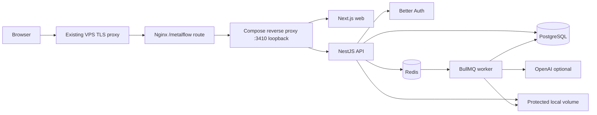

# Architecture

The API is a modular monolith. context.ts owns session/membership resolution, permission checks, transaction retry and audit helpers. commerce.ts owns document state transitions, reservations, fulfillment, receiving and payments. resources.ts defines validated DTO schemas. The controller binds transport to these services. Shared deterministic calculations live in packages/shared.

Database isolation is enforced with organization predicates and referenced-record ownership checks. RLS is not enabled in this release; database credentials remain private to containers. No external AI tool can mutate inventory or finance. File bytes are not served by static Nginx paths.

The frontend uses TanStack Query for server state, TanStack Table for record rendering, React Hook Form for forms and Radix dialogs for focus management. Navigation preferences are browser-local; business records are always server-persisted.

Module dependencies: identity/membership → CRM/catalog → inquiries → commercial documents → inventory/procurement → fulfillment → invoices/payments → analytics. Projects depend on customers, tasks/expenses and approved changes. AI and uploads are optional side paths, never prerequisites for deterministic operations. Cutting remains separate from physical stock consumption until an operator creates and executes work.
