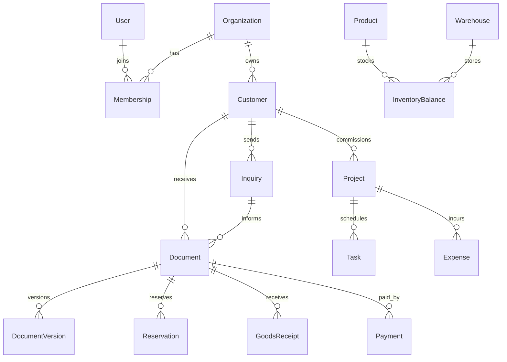

# Database schema
Authoritative schema: packages/database/prisma/schema.prisma. Initial migration: 202610290001_initial.

Document kinds are QUOTATION, ORDER, PURCHASE, INVOICE. Lines are immutable commercial JSON snapshots once a document leaves draft. A unique (organizationId, kind, sourceId) prevents duplicate conversions. Number uniqueness is per organization. DocumentVersion captures draft revisions.

Inventory uses Decimal(18,4). Money totals use Decimal(18,2), prices Decimal(18,4). Balance uniqueness is tenant/product/warehouse. Reservation uniqueness is tenant/order/product/warehouse. Payment and receipt idempotency keys are tenant-scoped.

Relations shown for business entities are validated at the service layer in this initial schema; identity relations have database foreign keys. Tenant ownership indexes exist on major list/filter paths. Further composite foreign keys and normalized line tables are planned defense in depth, not claimed as implemented.

State transitions are in commerce.ts. Issued invoices accept partial payments up to the outstanding balance. Fulfillment consumes reserved stock. Approved purchases allow partial receipts up to ordered quantities.
